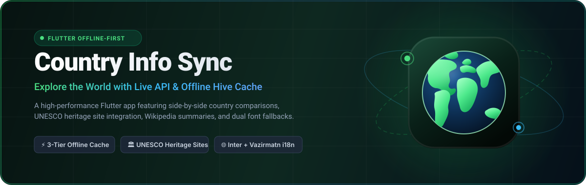
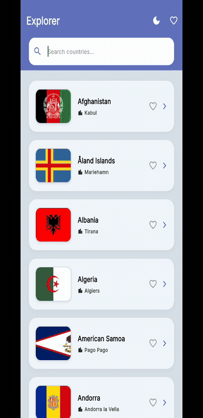

<p align="center">
  <a href="https://github.com/moradzadeh67/country_info_sync">
    
  </a>
</p>

<p align="center">
  <a href="https://github.com/moradzadeh67/country_info_sync/releases/latest">
    
  </a>
  <a href="https://opensource.org/licenses/MIT">
    
  </a>
  <a href="https://flutter.dev">
    
  </a>
  <a href="https://github.com/moradzadeh67/country_info_sync/actions/workflows/ci.yml">
    
  </a>
  <a href="https://moradzadeh67.github.io/country_info_sync/">
    
  </a>
</p>

<p align="center">
  <a href="https://github.com/moradzadeh67/country_info_sync/releases/latest"><b>📥 Download Latest APK</b></a> •
  <a href="https://moradzadeh67.github.io/country_info_sync/"><b>🌐 Live Web Demo</b></a> •
  <a href="#-features"><b>✨ Features</b></a> •
  <a href="#-architecture"><b>🏗️ Architecture</b></a> •
  <a href="#-installation--running"><b>🚀 Getting Started</b></a> •
  <a href="#-troubleshooting--faq"><b>❓ FAQ</b></a>
</p>

---

## 🌍 What is Country Info Sync?

**Country Info Sync** is a **free, open-source country information app** built with **Flutter**. It is **offline-first** and runs on **Android, iOS, macOS and the web**.

Look up any country and see its flag, capital, population, area, languages, currencies, timezones, calling code and bordering countries. Save favourites, compare two countries **side by side**, read **UNESCO World Heritage** entries, and pull a short **Wikipedia** summary — all of it cached locally with Hive, so the app still works with no internet connection.

- ✅ **100% free** — no ads, no accounts, no tracking
- ✅ **MIT licensed** — read it, fork it, ship it
- ✅ **No API keys required** — every upstream service is open
- ✅ **Works offline** — three-tier fallback: live API → Hive cache → bundled data

## 💡 Why I Built This

I wanted to explore a real-world Flutter project that combines **live API data**, **offline-first caching**, and **rich country information** in a single app. Most country explorer apps I found were either too basic (just a list of names) or too complex (over-engineered state management). Country Info Sync is my attempt at a **balanced middle ground**: a clean, adaptive UI with smart caching, persistent favorites, and a side-by-side comparison mode — all without adding unnecessary dependencies.

## 🎬 Demo



A 30-second tour: browse the list, search by name, save a favourite, open a country's details with its Wikipedia summary, then switch to dark mode.

## 📸 Screenshots

### macOS
| Home | Dark Mode | Details | Compare |
|:---:|:---:|:---:|:---:|
|  |  |  |  |

### Android
| Home | Dark Mode | Details | Compare |
|:---:|:---:|:---:|:---:|
|  |  |  |  |

### iOS
| Home | Dark Mode | Details | Compare |
|:---:|:---:|:---:|:---:|
|  |  |  |  |

### Web
| Home | Dark Mode | Details | Compare |
|:---:|:---:|:---:|:---:|
|  |  |  |  |

> 💡 **Note:** Screenshots are stored in `assets/screenshots/` and organized by platform.

## ✨ Features

Here is what the app can do, in plain terms:

- 🌍 **Country Explorer** — A scrollable list of every country with its flag, name, and capital city.
- 🔍 **Smart Search** — Search by country name **or** capital, case-insensitive, with exact matches sorted first (e.g. typing "ira" puts *Iran* and *Iraq* above *Nigeria*).
- ❤️ **Favorites** — Tap the heart on any country to save it. Favorites are stored persistently and survive a full app restart.
- ⭐ **Favorites-only Filter** — A single toggle in the app bar narrows the list down to only your favorited countries (composes with the search box).
- ⚖️ **Compare Countries** — Long-press up to **2** countries to select them, then tap the floating **Compare** button to see their stats side by side (capital, population, area, continent, subregion, calling code, languages, currencies, timezones).
- 📄 **Country Details** — A rich detail screen with the flag (animated with a Hero transition), native name, and clearly grouped sections:
  - **General Information** — capital, population, subregion, area.
  - **Communication** — calling code, languages, timezones, currencies.
  - **Detailed Records** — full lists of languages, currencies, and border countries.
- 🏛️ **UNESCO Heritage Sites** — Countries with curated data show a heritage section with each site's name and description. Uses an offline-bundled JSON file, so no network is required.
- 📖 **Wikipedia Insight** — An "About <country>" card with a short summary pulled from the Wikipedia REST API, including a link to the full article. Summaries are cached for offline reuse.
- 🌗 **Dark & Light Theme** — Toggle between themes from the app bar. The choice is remembered across restarts.
- 💾 **Offline-First** — Country data is cached in Hive; if the network is unavailable a bundled `countries.json` is used as a final fallback.
- 📱 **Polished, Adaptive UI** — Responsive spacing that scales across screen sizes, shimmer loading placeholders, graceful empty/error states, and auto-shrinking text for very long country names.
- 🌐 **Localization & Font Fallback** — Latin text uses **Inter**; Persian/Arabic glyphs automatically fall back to **Vazirmatn**, ensuring mixed strings render flawlessly.

## 🌐 Localization & Language Support

Country Info Sync is built with first-class internationalization (i18n) goals:
- **Primary Target Languages:** Persian (Farsi) & English.
- **Font & Glyph Management:** Uses `google_fonts` with glyph-level fallback. English/Latin characters utilize **Inter**, while Persian/Arabic glyphs automatically fall back to **Vazirmatn**.
- **Layout Adaptation:** Automatic RTL (Right-To-Left) / LTR support via Flutter's `flutter_localizations` delegate setup.

## 🗺️ Roadmap

- [x] Country explorer with flags & capital
- [x] Smart search (name + capital)
- [x] Favorites with persistence
- [x] Favorites-only filter
- [x] Compare two countries side by side
- [x] Country details with Hero animation
- [x] UNESCO heritage sites (offline)
- [x] Wikipedia insight with caching
- [x] Dark / Light theme with persistence
- [x] Offline-first data layer (3-tier fallback)
- [x] Responsive design system (screen-relative spacing)
- [ ] Localization (Persian as primary language)
- [ ] Historical data / charts
- [ ] Search by continent / region
- [ ] Export favorites to JSON

## 🛠️ Technical Decisions

Every technical choice in Country Info Sync was made with **simplicity, maintainability, and offline-first behavior** in mind:

- **No external state management** — The app uses plain `StatefulWidget` + `setState` for UI state, and a single `ValueNotifier<ThemeMode>` for the theme. For a project of this size, this keeps the codebase readable and avoids unnecessary boilerplate (no Provider, BLoC, or Riverpod).
- **`hive` over `shared_preferences`** — Hive supports typed boxes (`Box<Country>`) and stores entire objects without needing manual JSON serialization. It's fast, has zero native dependencies on some platforms, and works seamlessly offline.
- **`http` over `dio`** — The app only calls two simple REST endpoints (`countries.dev` and the Wikipedia REST API). Using `http` keeps the dependency footprint minimal.
- **Hand-written `CountryAdapter`** — Instead of adding `hive_generator` + `build_runner` as dev dependencies, the adapter is written by hand. This keeps the build fast and the project free of code-generation tooling.
- **Screen-relative design system** — All spacing and sizing derive from `MediaQuery` (via `AppSpacing`). No absolute pixel constants. This makes the UI scale proportionally from small phones to large tablets without breakpoints or media queries scattered across widgets.
- **Glyph-level font fallback** — Latin text uses **Inter**, but Persian/Arabic glyphs automatically fall back to **Vazirmatn** at the glyph level. This means mixed strings like `"Iran (جمهوری اسلامی)"` render correctly without any per-widget direction logic.
- **3-tier data fallback** — Country data is fetched in this order: **live API → Hive cache → bundled `countries.json`**. The app remains useful even with zero connectivity.

## 📦 Key Dependencies

| Package | Version | Purpose |
|---|:---:|---|
| `hive_flutter` | `^1.1.0` | Fast, lightweight key-value offline database for country & setting persistence |
| `http` | `^1.6.0` | Minimal HTTP client for fetching country data and Wikipedia REST summaries |
| `google_fonts` | `^8.2.1` | Dynamic typography with **Inter** and **Vazirmatn** glyph fallbacks |
| `cached_network_image` | `^4.0.2` | High-performance image caching for country flags |
| `url_launcher` | `^6.3.2` | Opening external Wikipedia articles safely in native browser/custom tabs |
| `flutter_localizations` | `sdk` | Core Flutter i18n and RTL layout support |

## 🏗️ Architecture

Country Info Sync follows a clean layered architecture without external state management:

### Project Structure


### Architecture Layers


### Data Flow


### Layer Breakdown

```text
lib/
├── main.dart                     → Entry point: Hive init, theme setup
├── models/
│   ├── country.dart              → Country model + hand-written Hive adapter
│   ├── country_insight.dart      → Wikipedia summary model
│   └── heritage_site.dart        → UNESCO heritage site model
├── services/
│   ├── country_service.dart      → API sync + Hive cache + asset fallback
│   ├── favorites_service.dart    → Read/write favorite country names
│   ├── heritage_service.dart     → Loads the bundled heritage JSON
│   └── wikipedia_service.dart    → Wikipedia summaries + caching
├── screens/
│   ├── home_screen.dart          → Country list, search, favorites & selection
│   ├── details_screen.dart       → Multi-section country details view
│   └── compare_screen.dart       → Side-by-side country comparison
├── theme/
│   ├── app_spacing.dart          → Responsive spacing/size tokens
│   └── app_typography.dart       → Inter + Vazirmatn typography
└── widgets/
    ├── country_card.dart         → Country list card
    ├── details_widgets.dart      → InfoTile, InsightCard, HeritageCard
    ├── shimmer_loading.dart      → Loading skeleton
    └── empty_state_view.dart     → Empty / error state placeholder
```

## 📱 Platform Support

| Platform | Status | Notes |
|---|:---:|---|
| 🤖 Android | ✅ Tested | Working on phones & tablets |
| 🍎 iOS | ✅ Tested | Working on iPhone & iPad |
| 🌐 Web | ✅ Tested | Chrome, Firefox, Safari compatible |
| 🖥️ macOS | ✅ Tested | Apple Silicon |
| 🪟 Windows | ⚠️ Untested | Build available |
| 🐧 Linux | ⚠️ Untested | Build available |

## 🚀 Installation & Running

> [!IMPORTANT]
> **Upgrading from v1.0.x?** In **v1.1.0** the Android application ID changed from `com.example.country_info_sync` to `io.github.moradzadeh67.country_info_sync`.
> Android treats these as two different apps, so **uninstall the old version first** — installing the new APK over it will fail with a signature/conflict error.
> Your locally saved favourites and cached data live in the old app's sandbox, so they will not carry over either.

### Prerequisites

- [Flutter SDK](https://docs.flutter.dev/get-started/install) (v3.47.2+)
- Dart SDK (^3.13.2)
- Platform-specific:
  - **Android**: Android SDK 24+ (`minSdk 24`, `targetSdk 36`)
  - **iOS**: Xcode 14+
  - **macOS**: Xcode 14+
  - **Web**: Any modern browser

### Getting Started

1. **Clone the repository**:
   ```bash
   git clone https://github.com/moradzadeh67/country_info_sync.git
   cd country_info_sync
   ```

2. **Install dependencies**:
   ```bash
   flutter pub get
   ```

3. **Run the application**:
   ```bash
   flutter run
   ```

### Building

```bash
# Build Android APK
flutter build apk --release

# Build macOS Desktop app
flutter build macos --release

# Build iOS app
flutter build ios --release

# Build Web distribution
flutter build web --release
```

## 🧪 Testing & Quality Assurance

To ensure code quality, static analysis compliance, and UI regression prevention:

```bash
# Analyze code for errors and lint compliance
flutter analyze

# Run unit and widget tests
flutter test
```

## 🔐 Release Signing

Release builds are signed with a keystore that lives **outside** the repository. Its
credentials are read from `android/key.properties`, which is git-ignored and never committed.

```properties
# android/key.properties — NEVER commit this file
storePassword=YOUR_STORE_PASSWORD_HERE
keyPassword=YOUR_KEY_PASSWORD_HERE
keyAlias=YOUR_KEY_ALIAS_HERE
storeFile=/absolute/path/to/your/upload-keystore.jks
```

Create your own upload key with `keytool`:

```bash
keytool -genkeypair -v \
  -keystore ~/keystores/country_info_sync.jks \
  -storetype JKS -keyalg RSA -keysize 2048 -validity 10000 \
  -alias country_info_sync \
  -dname "CN=your-name, OU=Development, O=your-name, C=IR"
```

Then build and verify the signed APK:

```bash
flutter build apk --release

# Confirm which key signed it
$ANDROID_HOME/build-tools/<version>/apksigner verify --print-certs \
  build/app/outputs/flutter-apk/app-release.apk
```

> [!NOTE]
> If `android/key.properties` is missing — on a fresh clone, for example — Gradle
automatically falls back to the debug signing key. The build never breaks; it simply
is not signed with the release key.

> [!CAUTION]
> Back up your keystore and its passwords somewhere safe. If the upload key is lost
you can no longer publish updates for this app.

## 🔄 CI/CD & Live Demo

| Workflow | Trigger | What it does |
|---|---|---|
| [`ci.yml`](.github/workflows/ci.yml) | push & PR to `main` | Runs `flutter analyze` and `flutter test` on Flutter 3.47.2 |
| [`deploy-web.yml`](.github/workflows/deploy-web.yml) | push to `main` | Builds the web bundle and publishes the site to GitHub Pages |

**Published site:** <https://moradzadeh67.github.io/country_info_sync/>

The site is assembled in CI from two parts:

- `/` — a static, crawlable HTML landing page from [`landing/index.html`](landing/index.html), plus `robots.txt`, a `sitemap.xml` and a 1200×630 social share image. A Flutter web build renders into a canvas and exposes almost no text to search engines, so this page is the part that actually gets indexed.
- `/app/` — the Flutter web app itself, built with `--base-href /country_info_sync/app/`.

[](https://github.com/moradzadeh67/country_info_sync/actions/workflows/ci.yml)

> [!NOTE]
> No secrets live in this repository. `android/key.properties`, `*.jks` and `*.keystore`
are all ignored by Git, and **no API keys are required** to run the app.

## ❓ Troubleshooting & FAQ

<details>
<summary><b>1. How does the offline fallback mechanism work?</b></summary>

Country Info Sync implements a 3-tier fallback strategy:
1. **Live Network:** On launch, the app attempts to fetch fresh data from `countries.dev`.
2. **Hive Local Cache:** If offline or the request fails, Hive returns previously cached data.
3. **Bundled Asset Fallback:** On a fresh install with zero internet connection, the app hydrates using the bundled `assets/data/countries.json` dataset.
</details>

<details>
<summary><b>2. How do I clear or reset local Hive boxes?</b></summary>

If you encounter stale data or want to test first-launch behavior, clear the application data via your OS Settings, or uninstall and reinstall the app.
</details>

<details>
<summary><b>3. Why are build_runner or hive_generator missing?</b></summary>

To eliminate code-generation overhead and reduce build times, `CountryAdapter` is hand-written directly in `lib/models/country.dart`.
</details>

## 💻 Development Environment
This project is developed and tested on:

* Hardware: MacBook Pro (Apple M3 Pro)
* OS: macOS 27.0.1
* IDE: VS Code / Android Studio
* Xcode: Xcode 27.0
* Flutter: Flutter 3.47.2 • channel stable • https://github.com/flutter/flutter.git

## 📋 Requirements
* Dart SDK: ^3.13.2

## 🙏 Credits & Attribution

Country Info Sync uses the following free and open APIs:

- **[countries.dev](https://countries.dev)** — Country data (flags, population, capital, languages, currencies, timezones, borders, area, region, subregion, calling codes)
- **[Wikipedia REST API](https://www.mediawiki.org/wiki/API:REST_API)** — Country insight summaries (`extract` field)
- **[UNESCO World Heritage Centre](https://whc.unesco.org)** — Heritage sites reference

**Data flow:** The app fetches country data from `countries.dev` on first launch, caches it locally with **Hive**, and falls back to a bundled `countries.json` if the network is unavailable. Wikipedia summaries are cached separately and reused offline.

**No API keys are required** — all three services are open and free to use.

## 🤝 Contributing

Contributions are welcome! Please read [CONTRIBUTING.md](CONTRIBUTING.md) for guidelines on how to get started.

## 📄 License

This project is licensed under the MIT License — see the [LICENSE](LICENSE) file for details.

Copyright © 2026 moradzadeh67
